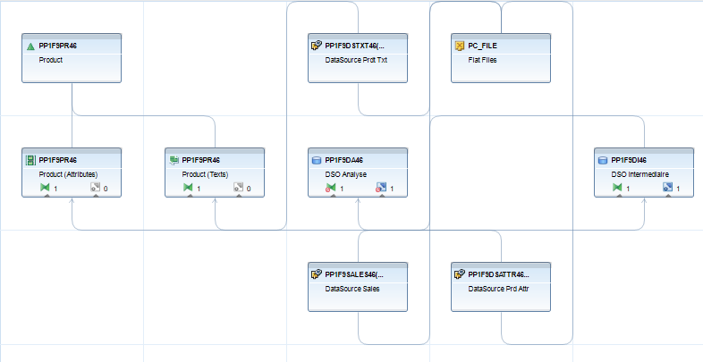
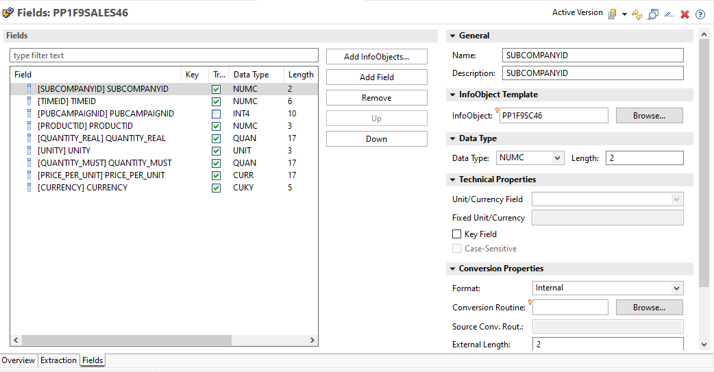
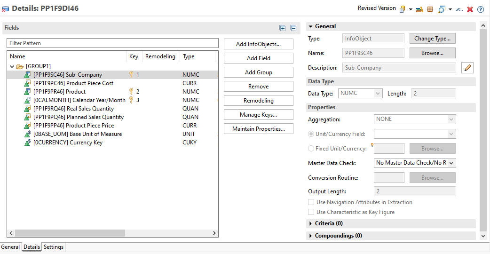
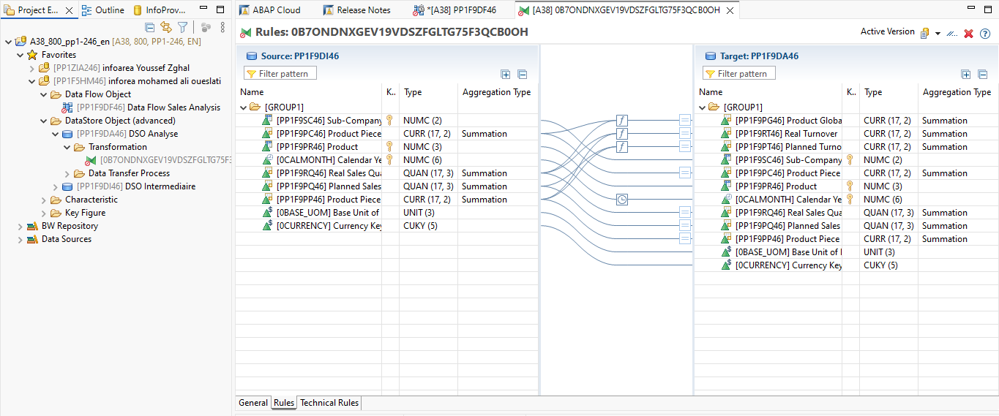
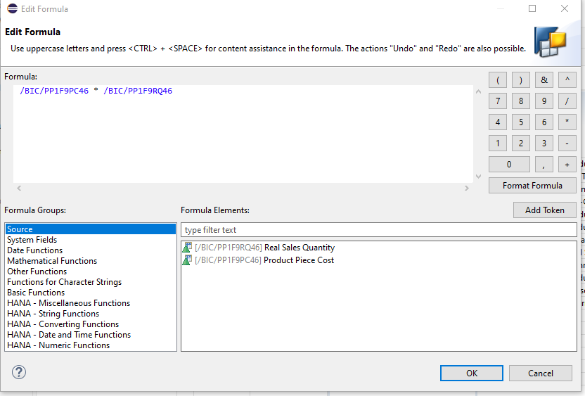
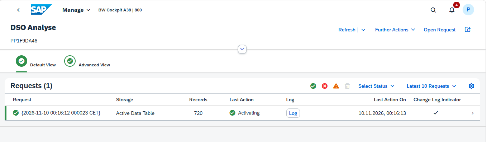
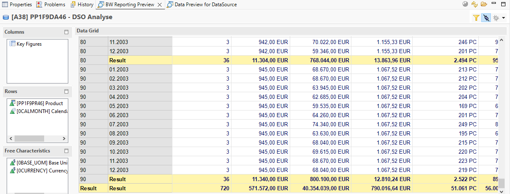

# Analyse des ventes avec SAP BW/4HANA

Projet réalisé sous Eclipse (BW Modeling Tools) : chargement de fichiers plats, modélisation de DSO, transformation avec formules, puis restitution dans BW Reporting Preview.

## Objectif
Charger les données produits et ventes, calculer le coût global et les chiffres d'affaires, puis analyser les résultats par produit et par mois.

## Architecture
| Couche | Objet | Rôle |
|---|---|---|
| Source | `PC_FILE` | Fichiers plats (CSV) |
| DataSources | `PP1F9DSTXT46`, `PP1F9DSATTR46`, `PP1F9SALES46` | Textes produits, attributs produits, ventes |
| InfoObject | `PP1F9PR46` | Produit (attributs et textes) |
| DSO intermédiaire | `PP1F9DI46` | Stockage des données de ventes chargées |
| DSO d'analyse | `PP1F9DA46` | Données enrichies par la transformation |

## Étapes

### 1. Data Flow

### 2. DataSource des ventes
Champs : sous-société, période, produit, quantités réelle et prévue, unité, prix unitaire, devise.

### 3. DSO intermédiaire
Clés : Sub-Company, Product, Calendar Year/Month.

### 4. Transformation vers le DSO d'analyse
Trois règles de type formule alimentent : Product Global Cost, Real Turnover et Planned Turnover.

### 5. Formule du coût global
`Product Global Cost = Product Piece Cost * Real Sales Quantity`

### 6. Chargement du DSO d'analyse
Requête chargée avec succès : **720 enregistrements**.

### 7. Reporting
Analyse par produit et par mois dans BW Reporting Preview (total : 720 enregistrements).

## Compétences mises en œuvre
SAP BW/4HANA, modélisation de DSO, DataSources sur fichiers plats, transformations et formules, DTP, BW Cockpit, reporting.
